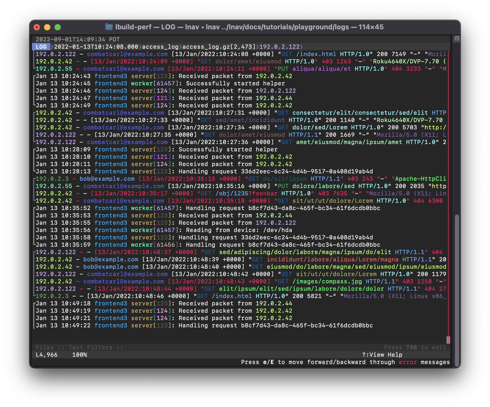

> **语言**：本文档为简体中文翻译，[点此查看英文原版 README.md](README.md)。

<!-- This is a comment for testing purposes -->

[](https://github.com/tstack/lnav/actions?query=workflow%3Aci-build)
[](https://docs.lnav.org)
[](https://coveralls.io/github/tstack/lnav?branch=master)
[](https://snapcraft.io/lnav)
[](https://gurubase.io/g/lnav)

[](https://discord.gg/erBPnKwz7R)

_本仓库是 **lnav** 的源代码仓库，整体概览请访问 [https://lnav.org](https://lnav.org)。_

# LNAV —— 日志文件导航器

日志文件导航器（Logfile Navigator）是一款终端日志文件查看器。 给定一组
文件/目录，**lnav** 将会：

- 按需解压；
- 检测它们的格式；
- 按时间把文件合并为一个统一视图；
- 追踪文件、跟随重命名、在目录中发现新文件；
- 构建错误与警告索引；
- [美化打印 JSON-lines](https://docs.lnav.org/en/latest/formats.html#json-lines)。

随后，在 **lnav** 的 TUI 中，你可以：

- 快速跳转到上一个/下一个错误（[按 `e`/`E`](https://docs.lnav.org/en/latest/hotkeys.html#spatial-navigation)）；
- 使用正则表达式搜索（[按 `/`](https://docs.lnav.org/en/latest/hotkeys.html#spatial-navigation)）；
- 用正则表达式高亮文本（[`:highlight`](https://docs.lnav.org/en/latest/commands.html#highlight-pattern) 命令）；
- 使用[正则表达式](https://docs.lnav.org/en/latest/usage.html#regular-expression-match)或 [SQLite 表达式](https://docs.lnav.org/en/latest/usage.html#sqlite-expression)过滤消息；
- 美化打印结构化文本（[按 `P`](https://docs.lnav.org/en/latest/ui.html#pretty)）；
- 查看随时间变化的消息直方图（[按 `i`](https://docs.lnav.org/en/latest/ui.html#hist)）；
- 使用 SQLite 分析消息（[按 `;`](https://docs.lnav.org/en/latest/sqlext.html)）

## 截图

以下截图展示了 syslog 与 web 访问日志文件的混合视图。
失败的请求以红色显示。 IP 地址和 PID
等标识符会进行语义化高亮。

[](docs/assets/images/lnav-front-page.png)

## 为什么不**直接**用 `tail`/`grep`/`less`？

标准的 Unix 工具在处理原始文本行时非常出色，
但它们并不理解日志消息。 Tail 可以同时监视
多个文件，但它不会按时间顺序显示消息，
也无法向后滚动。 Grep 只会找到匹配的行，
但不会返回完整的多行日志消息。 Less 一次只能
显示一个文件。 而且，这些基础工具没有一个
能处理压缩文件。

## 安装前可先在线试用

你可以先 SSH 登录一台演示节点，安装之前先玩一玩 lnav。

"playground" 账户会带着几个日志文件启动 lnav
作为示例：

[`$ ssh playground@demo.lnav.org`](ssh://playground@demo.lnav.org)

"tutorial 1" 账户是一个交互式教程，可以教你
基本操作：

[`$ ssh tutorial1@demo.lnav.org`](ssh://tutorial1@demo.lnav.org)

## 安装

[从发布页面下载 Linux/MacOS/Windows 的静态链接二进制文件](https://github.com/tstack/lnav/releases/latest#release-artifacts)

### MacOS 上的 Brew

```console
$ brew install lnav
```

### FreeBSD

```console
$ pkg install lnav
```

## 用法

只需让 **lnav** 指向你想要监视的文件或目录，
其余的它会自己搞定：

```console
$ lnav /path/to/file1 /path/to/dir ...
```

**lnav** 的 TUI 会立即弹出并开始为文件建立索引。
进度显示在底部的 "Files" 面板中。 索引建立完成后，LOG 视图就会
显示所识别出的日志消息[^1]。 之后你可以用
惯用的快捷键在视图中移动（方向键或
`j`/`k`/`h`/`l` 分别向下/上/左/右移动）。

更多信息参见在线文档的
[用法章节](https://docs.lnav.org/en/latest/usage.html)。

[^1]: 不包含日志消息的文件可以在
      TEXT 视图（按 `t` 键进入）中看到。

### 与 `systemd-journald` 配合使用

在运行 `systemd-journald` 的系统上，你可以把 `lnav` 用作分页器：

```
$ journalctl | lnav
```

或者以跟随模式：

```
$ journalctl -f | lnav
```

由于 `journalctl` 的默认输出格式会省略年份，如果你查看的日志
跨越多个年份，就需要让输出格式包含年份，
否则 `lnav` 会犯糊涂：

```
$ journalctl -o short-iso | lnav
```

也可以使用 `journalctl` 的 json 输出格式，`lnav`
会利用额外的字段，例如 PRIORITY 和 \_SYSTEMD_UNIT：

```
$ journalctl -o json | lnav
```

如果某些 MESSAGE 字段包含特殊字符（例如 ANSI 颜色码），
而它们在 journalctl 中被视为不可打印字符，
此时指定 `journalctl` 的 `-a` 选项可能更合适，
以便仍以非二进制形式输出这些消息：

```
$ journalctl -a -o json | lnav
```

如果使用 systemd v236 或更新版本，可以把输出字段限制为
`lnav` 实际能识别的那些，以获得更高的效率：

```
$ journalctl -o json --output-fields=MESSAGE,PRIORITY,_PID,SYSLOG_IDENTIFIER,_SYSTEMD_UNIT | lnav
```

如果你的系统已经运行了很长时间，为了更高的效率，
你可能想限制输入 `lnav` 的日志行数，
例如通过 `journalctl` 的 `-n` 或 `--since=...` 选项。

对于持久化日志（persistent journal），你可能想通过
`journalctl` 的 `-b` 选项来限制输入 `lnav` 的日志行数。

## 支持

请在本仓库提交 issue，或使用讨论区（Discussions）。
以下渠道同样可用：

- [support@lnav.org](mailto:support@lnav.org)
- [Discord](https://discord.gg/erBPnKwz7R)
- [Google Groups](https://groups.google.com/g/lnav)

## 链接

- [主站](https://lnav.org)
- Read the Docs 上的[**文档**](https://docs.lnav.org)
- [内部架构](ARCHITECTURE.md)

## 贡献

- [成为 GitHub 赞助者](https://github.com/sponsors/tstack)

### 从源码构建

#### 前置条件

构建 lnav 需要以下软件包：

- gcc/clang    - 兼容 C++14 的编译器。
- libpcre2     - Perl 兼容正则表达式 v2（PCRE2）库。
- sqlite       - SQLite 数据库引擎。 需要 3.9.0 或更高版本。
- zlib         - zlib 压缩库。
- bz2          - bzip2 压缩库。
- libcurl      - 用于从 URL 下载文件的 cURL 库。 需要 7.23.0 或更高版本。
- libarchive   - 用于打开 zip/tgz 等归档文件的 libarchive 库。
- libunistring - 用于处理 unicode 的 libunistring 库。
- wireshark    - 'tshark' 程序用于解析 pcap 文件。
- cargo/rust   - Rust 语言用于构建 PRQL 编译器。

#### 构建

Lnav 按常见的 GNU 风格进行配置与安装：

如果从克隆的仓库编译，请先运行 `./autogen.sh`。

```console
$ ./configure
$ make
$ sudo make install
```

## 另见

[Angle-grinder](https://github.com/rcoh/angle-grinder) 是一款在命令行上灵活拆分与统计日志文件的工具。
如果你熟悉 SumoLogic 查询语言，可能会觉得这个工具用起来更顺手。

## 代码签名政策

由 [SignPath.io](https://about.signpath.io/) 提供免费代码签名，
证书由 [SignPath Foundation](https://signpath.org/) 提供。

除非用户本人——或安装、操作它的人——明确提出请求，
本程序不会向其他联网系统传输任何信息。

## 致谢

特别感谢：

* GitHub Sponsors
* Anthropic 将 lnav 纳入 Claude for Open Source Program
